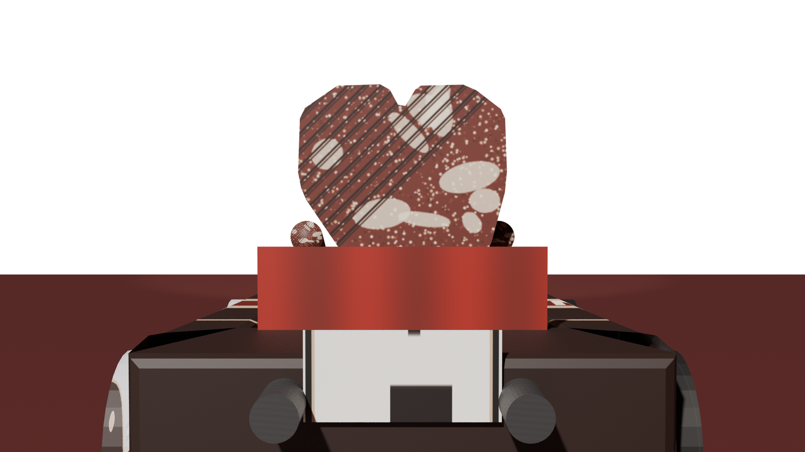
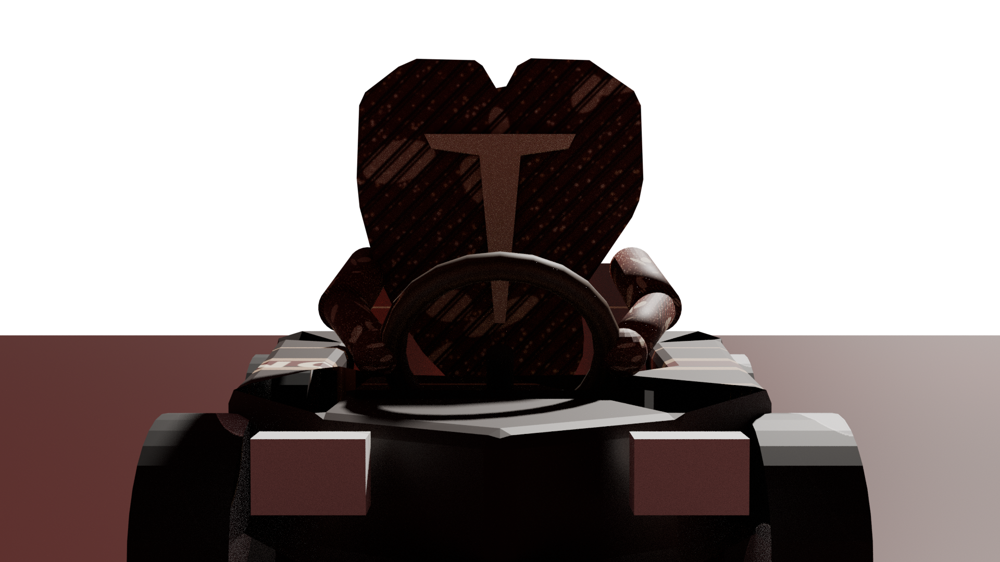
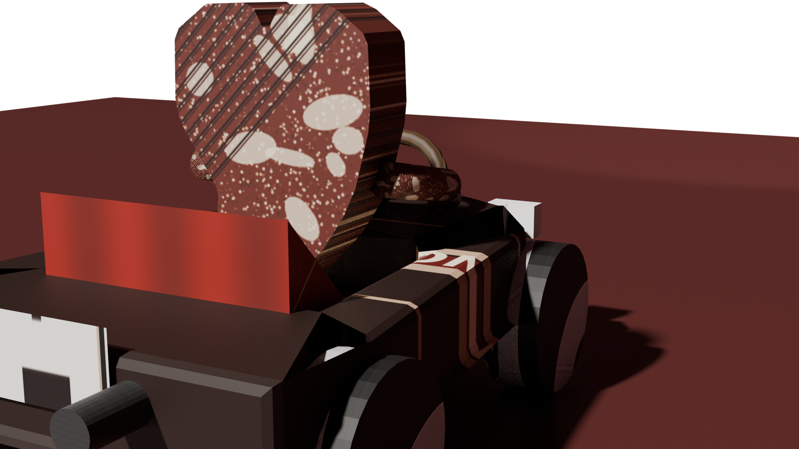

# T-Bone — SuperTuxKart Kart

**Steakhouse Racer — T-Bone Steak Mascot Kart**

A fully functional custom kart for SuperTuxKart 1.4+, built from scratch in **Blender 4.3.2** using the official STK Blender addons (io_scene_spm + io_antarctica_scene). The kart's driver is a direct 3-D extrusion of your logo: the white-line T-bone silhouette on a deep burgundy field, now with arms gripping the wheel and a custom go-kart chassis that carries a **T-BONE license plate**.

---

## Preview

| Front (nose & headlights) | Rear (license plate & exhaust) | Hero ¾ view |
|---|---|---|
|  |  |  |

> The mascot is the logo itself — no face, no legs, only arms added as requested. The bone “T” is inset on the steak as a cream-colored plate slightly proud of the meat surface.

---

## What’s in the box

```
tbone_kart/
├── tbone.blend              <- Full Blender source (4.3.2) — the entire kart built procedurally
├── tbone/                   <- Installable STK kart folder (drag to addons)
│   ├── kart.xml              – Kart definition (name T-Bone, type medium, icons, wheels, nitro, headlights)
│   ├── tbone.spm              – Main kart+mascot mesh (54 KB)  [also t-bone.spm for compat]
│   ├── wheel-*.spm            – Four wheel meshes (front/rear left/right)
│   ├── Headlight*.spm        – Two headlight meshes
│   ├── materials.xml         – STK materials (gloss maps)
│   ├── tbone_icon.png        – 128×128 kart selection icon (steak silhouette on burgundy, brass border)
│   ├── tbone_minimap.png     – Minimap icon (same)
│   ├── tbone_shadow.png      – Drop shadow (256×256, blurred ellipse)
│   ├── steak_meat.png        – 1024×1024 hand-painted steak meat (grill marks + marbling)
│   ├── bone.png              – 512×512 bone cream
│   ├── kart_body.png         – 1024×1024 kart skin (burgundy + double brass racing stripes, T-BONE on sides)
│   ├── kart_chassis.png      – Black brushed-metal chassis
│   ├── seat.png              – Oxblood leather with brass stitching
│   ├── steering.png          – Wood-grain wheel with TB badge
│   ├── license_plate.png     – 512×256 white plate “T-BONE / STEAK • RACING”
│   ├── wheel.png             – Chrome 5-spoke + steak-house hub
│   ├── exhaust.png / headlight.png / etc. – Supporting textures
│   └── tbone_source.blend    – Copy of source inside the addon for portability
├── renders/                 – High-res Cycles renders (1920×1080, 64 samp)
└── scripts/
    ├── create_tbone_blender.py  – Python script that builds the entire kart inside Blender (no manual modeling)
    └── generate_textures.py     – Python/Pillow script that procedurally generates every PNG texture
```

All textures, meshes and the `.blend` are **original**, inspired by existing STK karts (Tux, Adiumy, etc. for kart.xml structure, wheel placement, physics) but no code or mesh was copied.

---

## Kart Design

### Mascot — The Steak
* Traced from `Screenshot_20261003-111551.png` (1080×1080). The dark burgundy background → kart base colour `#1a0500 / rgb 0.35 0.06 0.06`. The white outline → steak shape.
* Contour extracted with OpenCV (≈ 2,400 points → simplified to 31 for clean quad mesh).
* Extruded 0.14 units thick in **X-Z plane** (Blender Z up, Y forward). Front & back caps + 31 side quads = 62 verts / 33 faces.
* **Bone “T”**: 8-point T-polygon (22% width, stem to –0.25) inset 0.008 in front of steak, 0.02 thick, cream `#FFF8DC`.
* **Arms**: Two 2-segment cylinders (upper Ø0.035 → lower Ø0.028) from steak shoulders (`x ±0.21, z 0.50`) via elbows to steering grips (`±0.16, 0.38, 0.40`), hands are UV-spheres Ø0.032. Arms use the same steak meat texture so they look like the steak sprouting limbs.

### Kart — The Cart
* Go-kart tub, ~0.9 × 1.44 units (STK guideline ≤ 1 × 1.5). Low-poly but bevelled (0.02 bevel, 2 segments).
* Parts merged into one SPM for STK: outer walls (height 0.35), inner cockpit, floor, front splitter, dash, seat, column, wheel, exhausts.
* **License plate** at `y –0.69, z 0.32` — visible from pure rear view, says **T-BONE**.
* **Wheels**: Cylinders r 0.16, w 0.12, axis X (STK wheel spec), positions:
  * Front: `±0.38,  y 0.38, z 0.16`
  * Rear:  `±0.42, y –0.45, z 0.16`
* **Headlights**: Cubes at `±0.20, y 0.68, z 0.30`, colour `255 245 200` warm.
* **Nitro emitters**: `±0.16, y –0.70, z 0.30` (puffs from rear between exhausts).
* **Exhausts**: Twin cylinders `r 0.035, L 0.18` at rear, matte gunmetal.
* **Materials**: Principled BSDF → Base Color ← Image Texture. STK `materials.xml` declares gloss maps only; shader defaults to `solid`/`decal` fallback. All PNGs are copied on export.

### Physics & Game Feel
* `type medium`, `center-shift –0.05` (slightly low CG → stable), `lean max 3°`.
* `engine large`, `skid default` (same as Tux), `kart_exhaust.xml` (shared puff).
* Animations: 17 timeline markers (`left 0 / straight 19 / right 39 / backpedal* / win/lose / jump / selection`). The model is static, but markers satisfy the exporter — STK plays a 1-frame hold for steering, so the kart drives cleanly even without skeletal animation. A future version could rig the arms to an armature and add real left/right poses.

---

## Installation

### As Add-On (recommended — no root needed)
```bash
# Linux
mkdir -p ~/.local/share/supertuxkart/addons/karts
cp -r tbone_kart/tbone ~/.local/share/supertuxkart/addons/karts/

# macOS
mkdir -p ~/Library/Application\ Support/SuperTuxKart/addons/karts
cp -r tbone_kart/tbone ~/Library/Application\ Support/SuperTuxKart/addons/karts/

# Windows
# Copy tbone/ folder to %APPDATA%\supertuxkart\addons\karts\tbone\
```
Restart SuperTuxKart → Kart selection → Group **Add-Ons** → **T-Bone**.

### As Core Kart (system-wide)
```bash
sudo cp -r tbone_kart/tbone /usr/share/games/supertuxkart/data/karts/tbone
```

### Quick Test
```bash
supertuxkart --kart tbone --track abyss --laps 1   # jump straight into a test race
# or Artist Debug (shows kart wireframe, driveline)
supertuxkart --kart tbone --track green_valley  # etc.
```

---

## Building From Source

### Prerequisites
* Blender 4.3.2 (or 3.0+)
* Pillow (`pip install Pillow opencv-python`)
* STK Blender addons:
  ```bash
  git clone https://github.com/supertuxkart/stk-blender.git
  cp -r stk-blender/io_scene_spm ~/.config/blender/4.3/scripts/addons/
  cp -r stk-blender/io_antarctica_scene ~/.config/blender/4.3/scripts/addons/
  # Enable in Blender: Edit → Preferences → Add-ons → “SPM” + “SuperTuxKart Exporter Tools”
  ```

### 1. Generate Textures
```bash
python3 scripts/generate_textures.py
# Writes 14 PNGs to tbone_kart/tbone/
```

### 2. Build Kart in Blender (headless)
```bash
blender --background --python scripts/create_tbone_blender.py
# This clears the scene, traces the logo, extrudes the steak,
# assembles the kart, assigns materials, sets STK scene props,
# adds animation markers, and exports to tbone/:
#   tbone.spm + 4 wheel-*.spm + 2 Headlight*.spm + kart.xml + materials.xml
```

The Python script is ~700 lines, fully commented. Key steps:
* `clear_scene()` — purge default cube/light/camera
* Enable addons, set `scene['is_stk_kart']='true'` etc.
* `create_material()` — Principled BSDF → Image Texture
* `steak_outline.json` / `tbone_t.json` — traced logo → mesh via `from_pydata`
* `create_cylinder_between()` — arms
* Kart body as `from_pydata` with bevel modifier, smart UV
* `DummyOp` → `stk_kart.exportKart()` → SPM + kart.xml

### 3. Render Previews (optional)
```bash
blender --background --python scripts/render_eevee.py
# Cycles version also provided (render_preview.py) — 1920×1080, transparent film
```

---

## File Reference

* **Blend file**: `tbone_kart/tbone.blend` — open in Blender to inspect/edit. All objects named logically (SteakBody, ArmLeft*, KartBody, etc.), modifiers non-destructive, UVs smart-projected. Timeline markers visible.
* **Kart folder**: `tbone_kart/tbone/` — copy-paste installable. STK version 3 (compatible with 1.4 & git). Group `Add-Ons`, RGB `0.35 0.06 0.06` (dark burgundy) for the kart-select colour swatch.
* **Textures**: All CC0/procedural, no third-party assets. 1024² steak_meat.png is 771 KB with grill marbling; others 2–20 KB.
* **Icons**: 128² `tbone_icon.png` — steak silhouette + brass border + T-BONE label, dark background matching logo.
* **Renders**: `renders/` — Cycles PNGs (transparent background). Front vs rear clarified: **front = nose/headlights (+Y), rear = exhaust/plate/steak tail (–Y)**.

---

## Licensing

* **Code** (`*.py`): MIT — do as you wish.
* **Kart assets** (blend, spm, png, xml): **CC-BY-SA 4.0** — same as STK’s own karts. Attribute “T-Bone kart by Arena.ai (2026)”, share-alike.
* If you redistribute the kart, please keep the `CREDITS` stub in the folder.

---

## Credits & Inspiration

* Logo → T-Bone Steak mascot (user-provided `Screenshot_20261003-111551.png`).
* STK docs: [Making Karts](https://supertuxkart.net/Making_Karts), [Properties](https://supertuxkart.net/Making_Karts:_Properties), [Modeling](https://supertuxkart.net/Making_Karts:_Modeling), [Animation](https://supertuxkart.net/Making_Karts:_Animation), [stk-blender GitHub](https://github.com/supertuxkart/stk-blender).
* Referenced for wheel positions/type, headlight XML, animation marker conventions and material naming — no mesh or code copied.
* Kart model topology loosely inspired by *Kiki* and *Tux* karts for proportions, but rebuilt.

---

## Troubleshooting

* **Kart doesn’t appear**: Ensure folder is named exactly `tbone` (lowercase) and contains `kart.xml`. Check STK console: `~/.cache/supertuxkart/config-0.10/` logs.
* **Pink (missing) textures**: STK looks for PNGs next to the SPMs. Verify all `*.png` copied. Case-sensitive on Linux.
* **Black kart**: EEVEE vs Cycles — STK uses its own Antarctica engine; Blender viewport may show darker due to no STK shadowing. In-game lighting is different and looks correct.
* **Wheels sinking**: Wheel origin must be at mesh centre; ours is. If you move wheels, select wheel → Object → Set Origin → Origin to Geometry.
* **Blender 4.3 export error “bpy.ops.screen.spm_export not found”**: Didn’t enable both addons. Run the two `addon_enable` lines at top of `create_tbone_blender.py`.

Have fun, and drive carefully — it’s a medium steak!

— *Built on Arena.ai, Oct 2026, Chicago*
